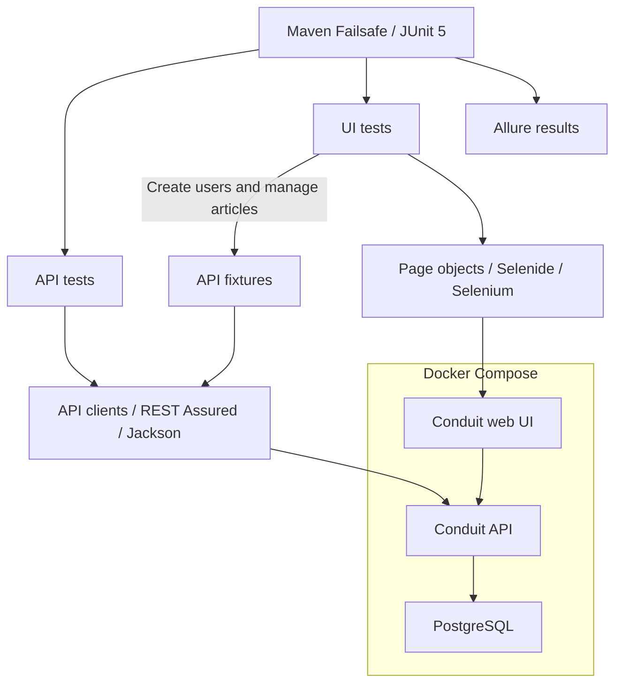

# RealWorld Conduit test automation

A Java 25 and JUnit 5 framework for testing RealWorld Conduit's API and browser journeys against a pinned Conduit application and PostgreSQL.

## Quick start

You need JDK 25, Maven 3.8.6 or newer, Docker Compose v2, and Chrome for the default UI run. Firefox and Edge are also supported.

```sh
docker compose up --build --wait --wait-timeout 120
mvn verify
mvn allure:serve
```

Conduit is available at [http://localhost:8080](http://localhost:8080). The tests register their own users and create their own articles. When finished, run `docker compose down`. Add `-v` to delete the test database and its data.

| Run | Command |
| --- | --- |
| API only | `mvn -Papi verify` |
| UI on Firefox | `mvn -Pui "-Dconduit.browser=firefox" verify` |
| Smoke tests | `mvn "-Dtest.groups=smoke" verify` |
| Full regression | `mvn "-Dtest.groups=regression" verify` |

## Architecture



See [CONTRIBUTING.md](CONTRIBUTING.md) for the project layout, configuration, and guidance on adding tests.
